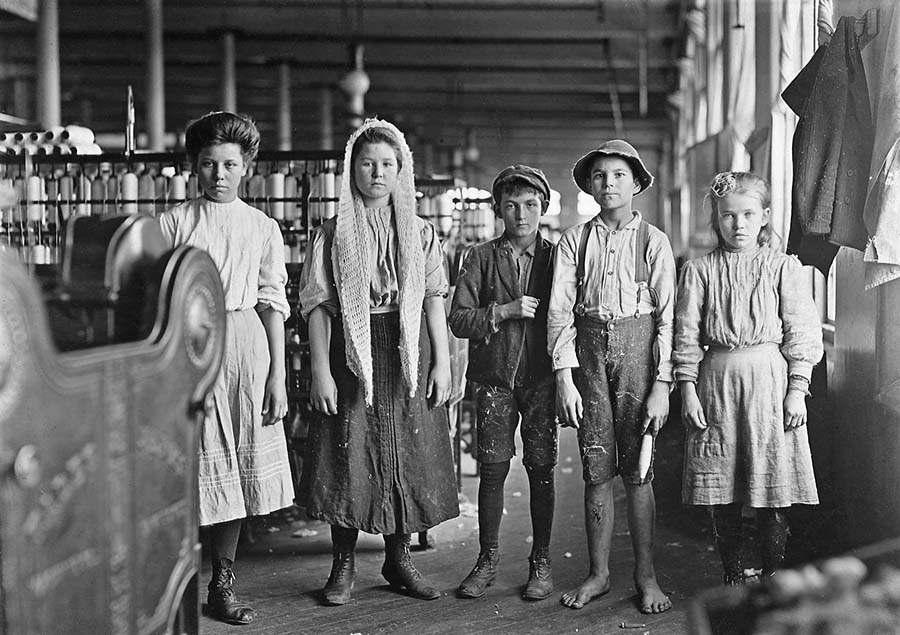
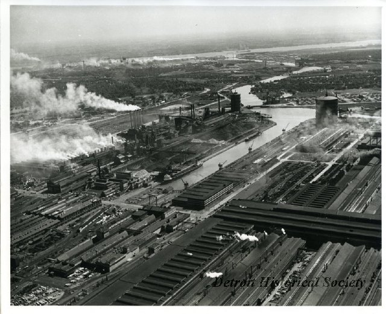
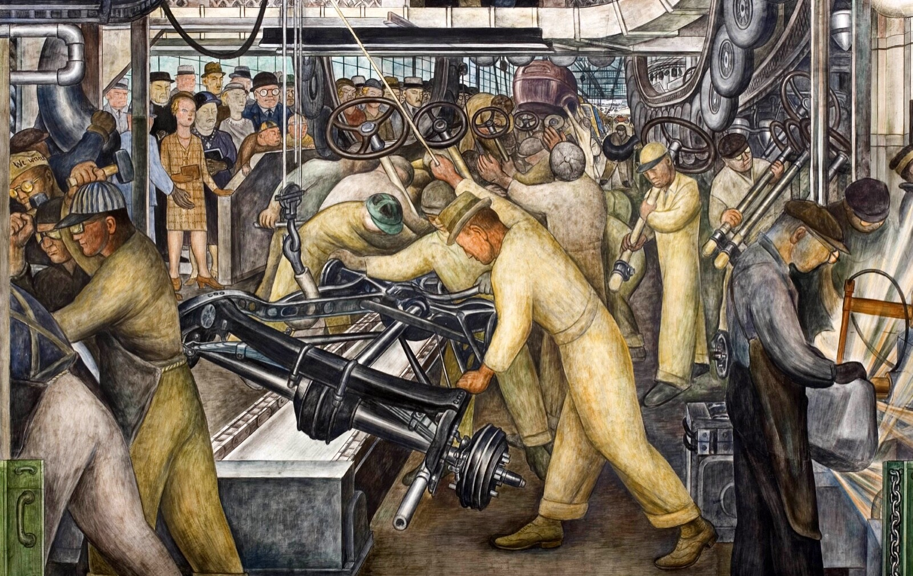
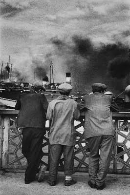

# ÇALIŞMA VE TOPLUM · GÖRSEL TEMSİLLER

## Etkinlik: “Görseli Oku”
**Grup çalışma kâğıdı** · **Süre:** Yaklaşık 30 dakika

### Amaç
Bir görsel, gerçekliği olduğu gibi göstermez; birinin bakışını ve amacını taşır. Bu etkinlikte elinizdeki görseli bir kaynak gibi okuyacak, görselin hangi mesajı verdiğini ve neyi dışarıda bıraktığını tartışacaksınız.

---

### Nasıl İşleyecek?

| Bölüm | Süre | Ne Yapacaksınız? |
| :--- | :--- | :--- |
| **Giriş** | 3 dk | Eğitmen etkinliği ve kuralları anlatır, gruplara kartlar dağıtılır. |
| **Grup çalışması** | 10 dk | Kartınızdaki görseli inceleyin, dört soruyu birlikte tartışın ve cevaplarınızı yazın. |
| **Sunumlar** | 10 dk | Her grup en fazla 2 dakika sunar. Sunumu bir grup üyesi yapar; dinleyen gruplar not alır. |
| **Ortak değerlendirme** | 5 dk | Görseller arasındaki farklar ve benzerlikler birlikte tartışılır. |
| **Çıkış notu** | 2 dk | Her öğrenci kâğıdın son sayfasındaki tek cümlelik notu doldurur. |

---

### Grup Çalışma Kuralları
- Gruplar 4–5 kişiden oluşur. Rol dağılımı: sunucu, yazıcı, zaman tutucu, görsel okuyucu (diğerleri tartışmaya katılır).
- Önce görsele sessizce 1 dakika bakın; ancak ondan sonra tartışmaya başlayın.
- Cevaplarınızda mutlaka görselden somut bir ayrıntıya dayanın (*“işçilerin kameraya bakması”*, *“arka plandaki makineler”* gibi).
- “Doğru–yanlış” cevap yoktur ama gerekçesiz cevap da kabul edilmez. Her yorumun nedenini söyleyin.
- Bilmediğiniz bir şeyi varsayım olarak belirtin: *“Bu fotoğrafı bir şirketin çektirmiş olabileceğini düşünüyoruz çünkü…”*

> **Hatırlatma: Dört Soru Çerçevesi**
> 1. Kim üretti?
> 2. Kimin için ve neden?
> 3. Ne gösteriliyor, ne gösterilmiyor?
> 4. Nasıl gösteriliyor?

---

### Grup Kartı 1

**Künye:** Fotoğraf · ABD · 20. yüzyılın başı · Ulusal Çocuk Emeği Komitesi (NCLC) arşivinden  
**Eser:** Lewis Hine — *İplik fabrikasında çalışan çocuklar*

  

* **Grup üyeleri:** __________________________________________________

| Soru | Grubumuzun Cevabı (Görselden ayrıntı verin) |
| :--- | :--- |
| **1. Kim üretti?** Görseli kim yaptı? Kim ısmarlamış, yayımlamış ya da paylaşmış olabilir? | |
| **2. Kimin için ve neden?** Hedef kitle kim? Görsel neyi başarmak istiyor: kanıt sunmak, tanıtmak, ikna etmek, anmak, harekete geçirmek? | |
| **3. Ne gösteriliyor, ne gösterilmiyor?** Görselde kimler ve hangi işler var? Çerçevenin dışında ne kalmış olabilir (patron, ücret, kadınlar, tehlike, işçinin sesi vb.)? | |
| **4. Nasıl gösteriliyor?** İşçi kurban mı, kahraman mı, makinenin parçası mı, verimli bir birim mi? Poz, ışık, bakış açısı ve renk bunu nasıl destekliyor? | |

**Sunum için tek cümle:**  
> *Bu görsel bize ______________________________ gösteriyor, ancak ______________________________ göstermiyor.*

---

### Grup Kartı 2

**Künye:** Fotoğraf · River Rouge fabrikası, ABD · 1917–1941 arasında şirketin fotoğraf biriminde çekilmiş  
**Eser:** Ford Foto-Film Departmanı — *River Rouge fabrikası*

  

* **Grup üyeleri:** __________________________________________________

| Soru | Grubumuzun Cevabı (Görselden ayrıntı verin) |
| :--- | :--- |
| **1. Kim üretti?** Görseli kim yaptı? Kim ısmarlamış, yayımlamış ya da paylaşmış olabilir? | |
| **2. Kimin için ve neden?** Hedef kitle kim? Görsel neyi başarmak istiyor: kanıt sunmak, tanıtmak, ikna etmek, anmak, harekete geçirmek? | |
| **3. Ne gösteriliyor, ne gösterilmiyor?** Görselde kimler ve hangi işler var? Çerçevenin dışında ne kalmış olabilir? | |
| **4. Nasıl gösteriliyor?** İşçi kurban mı, kahraman mı, makinenin parçası mı, verimli bir birim mi? Poz, ışık, bakış açısı ve renk bunu nasıl destekliyor? | |

**Sunum için tek cümle:**  
> *Bu görsel bize ______________________________ gösteriyor, ancak ______________________________ göstermiyor.*

---

### Grup Kartı 3

**Künye:** Duvar resmi · Detroit, ABD · 1932–33  
**Eser:** Diego Rivera — *Detroit Industry*

  

* **Grup üyeleri:** __________________________________________________

| Soru | Grubumuzun Cevabı (Görselden ayrıntı verin) |
| :--- | :--- |
| **1. Kim üretti?** Görseli kim yaptı? Kim ısmarlamış, yayımlamış ya da paylaşmış olabilir? | |
| **2. Kimin için ve neden?** Hedef kitle kim? Görsel neyi başarmak istiyor: kanıt sunmak, tanıtmak, ikna etmek, anmak, harekete geçirmek? | |
| **3. Ne gösteriliyor, ne gösterilmiyor?** Görselde kimler ve hangi işler var? Çerçevenin dışında ne kalmış olabilir? | |
| **4. Nasıl gösteriliyor?** İşçi kurban mı, kahraman mı, makinenin parçası mı, verimli bir birim mi? Poz, ışık, bakış açısı ve renk bunu nasıl destekliyor? | |

**Sunum için tek cümle:**  
> *Bu görsel bize ______________________________ gösteriyor, ancak ______________________________ göstermiyor.*

---

### Grup Kartı 4

**Künye:** Afiş · Türkiye · 2014 · Sendika tarafından hazırlanmış  
**Eser:** DİSK 1 Mayıs afişi (2014)

  

* **Grup üyeleri:** __________________________________________________

| Soru | Grubumuzun Cevabı (Görselden ayrıntı verin) |
| :--- | :--- |
| **1. Kim üretti?** Görseli kim yaptı? Kim ısmarlamış, yayımlamış ya da paylaşmış olabilir? | |
| **2. Kimin için ve neden?** Hedef kitle kim? Görsel neyi başarmak istiyor: kanıt sunmak, tanıtmak, ikna etmek, anmak, harekete geçirmek? | |
| **3. Ne gösteriliyor, ne gösterilmiyor?** Görselde kimler ve hangi işler var? Çerçevenin dışında ne kalmış olabilir? | |
| **4. Nasıl gösteriliyor?** İşçi kurban mı, kahraman mı, makinenin parçası mı, verimli bir birim mi? Poz, ışık, bakış açısı ve renk bunu nasıl destekliyor? | |

**Sunum için tek cümle:**  
> *Bu görsel bize ______________________________ gösteriyor, ancak ______________________________ göstermiyor.*

---

### Grup Kartı 5

**Künye:** Fotoğraf · İstanbul · 20. yüzyılın ikinci yarısı  
**Eser:** Ara Güler — *İstanbul’da Alınteri*

  

* **Grup üyeleri:** __________________________________________________

| Soru | Grubumuzun Cevabı (Görselden ayrıntı verin) |
| :--- | :--- |
| **1. Kim üretti?** Görseli kim yaptı? Kim ısmarlamış, yayımlamış ya da paylaşmış olabilir? | |
| **2. Kimin için ve neden?** Hedef kitle kim? Görsel neyi başarmak istiyor: kanıt sunmak, tanıtmak, ikna etmek, anmak, harekete geçirmek? | |
| **3. Ne gösteriliyor, ne gösterilmiyor?** Görselde kimler ve hangi işler var? Çerçevenin dışında ne kalmış olabilir? | |
| **4. Nasıl gösteriliyor?** İşçi kurban mı, kahraman mı, makinenin parçası mı, verimli bir birim mi? Poz, ışık, bakış açısı ve renk bunu nasıl destekliyor? | |

**Sunum için tek cümle:**  
> *Bu görsel bize ______________________________ gösteriyor, ancak ______________________________ göstermiyor.*

---

### Çıkış Notu (Bireysel)
Bugün gördüğünüz görsellerden birini seçin. Bu görselin neyi gösterdiğini ve neyi gizlediğini tek cümleyle yazın.

* **Seçtiğim görsel:** ________________________________________________
* **Gösterdiği:** ______________________________________________________________________________
* **Gizlediği:** _______________________________________________________________________________

---

### Düşünmeye Devam Edin
*Kendi çevrenizdeki bir işi tek bir fotoğrafla anlatsaydınız neyi çerçeveye alır, neyi dışarıda bırakırdınız?*
